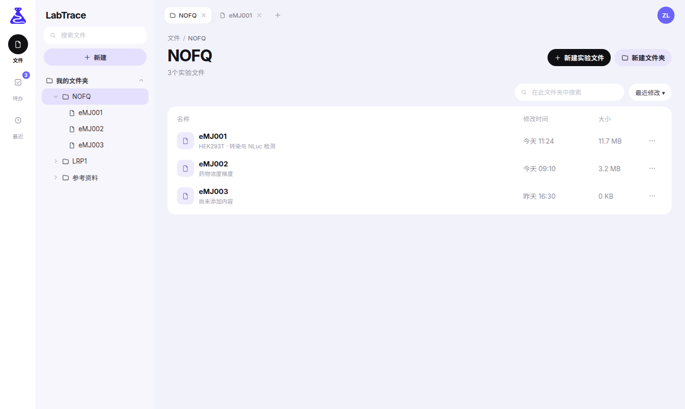
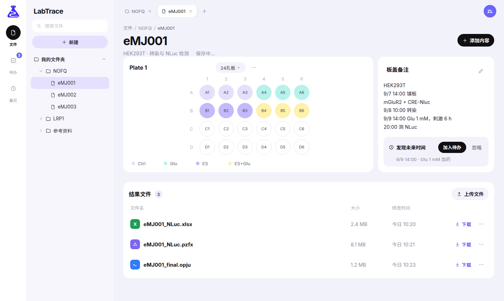
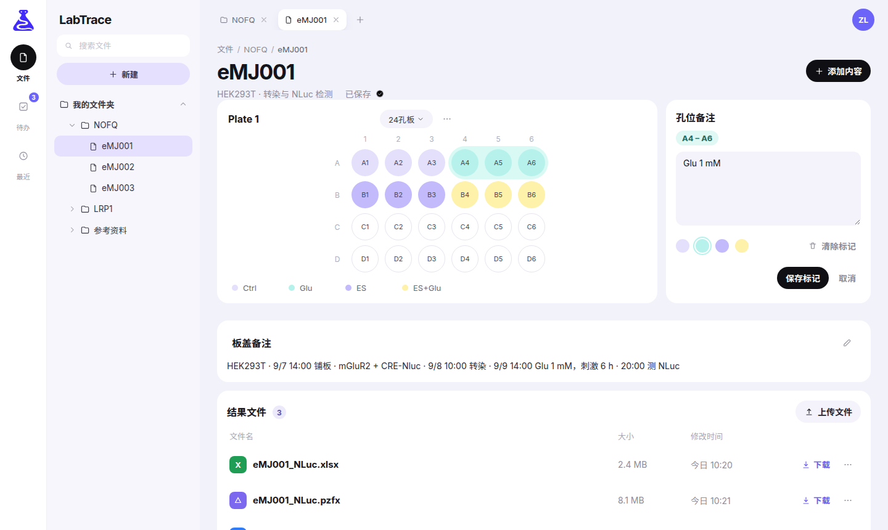
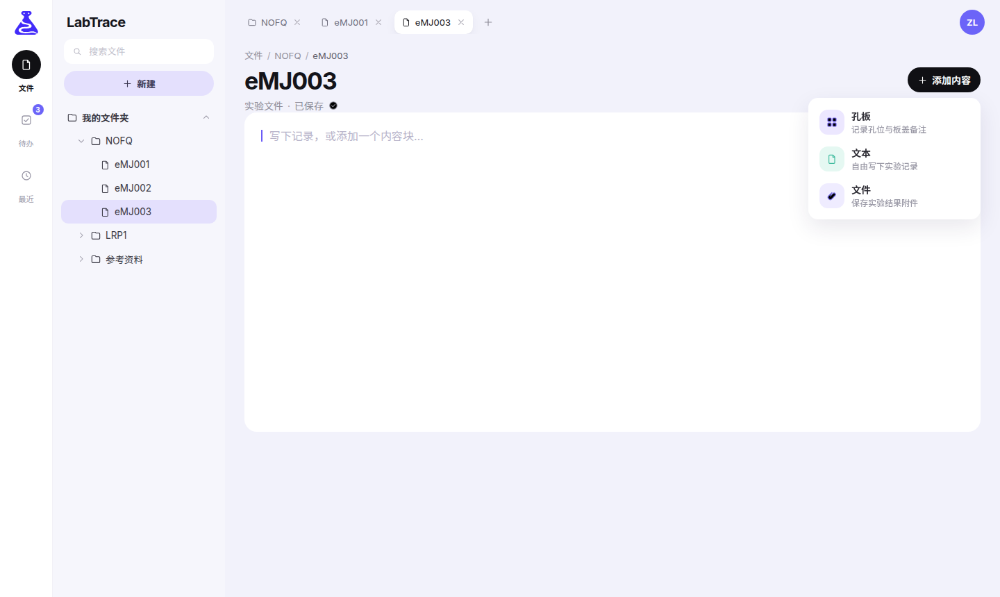
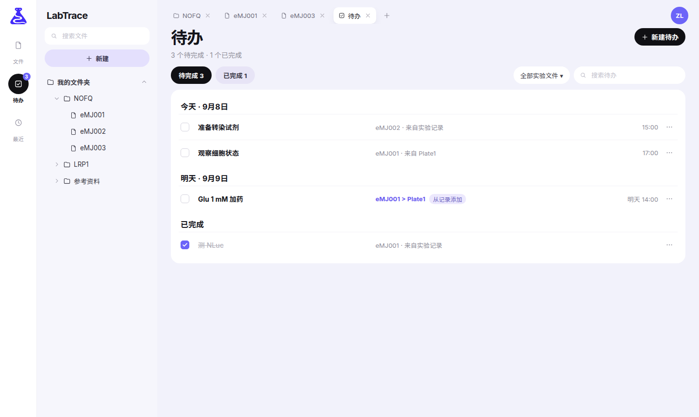
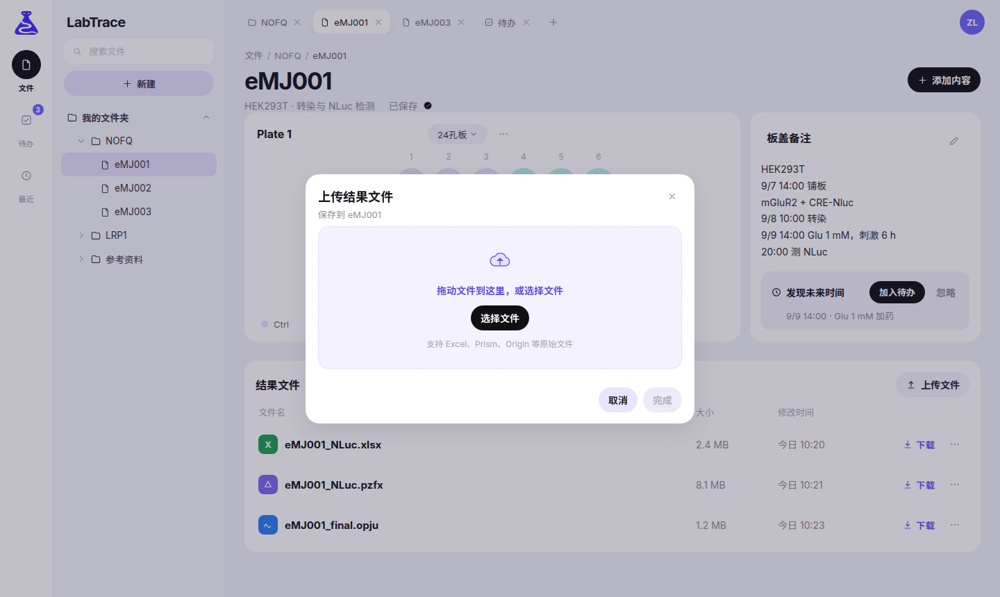

# LabTrace

LabTrace 是一个跨平台桌面应用，用来管理实验记录、孔板标记和待办。界面为简体中文。数据保存在本机 SQLite，结果附件保存在应用数据目录。

技术栈：Tauri 2、React、TypeScript、Vite。许可证：[AGPL-3.0](LICENSE)。

## 功能

- 文件夹树：嵌套文件夹和实验文件的新建、重命名、移动、删除（需确认）、排序和搜索
- 实验文件：标题、备注、面包屑，以及可排序的孔板 / 文本 / 结果文件块，带自动保存状态
- 孔板：6 / 12 / 24 / 48 / 96 孔，点选或拖拽选择，分组颜色和图例可改，孔位备注、清除标记、板盖备注
- 未来时间：板盖备注和文本块里识别 `9/9 14:00`、`明天 14:00`、`明天下午3点`、`下周一 10:00`，以及紧挨上一行日期的单独时间（如 `20:00 测 NLuc`）。可以加入待办或忽略，忽略会被记住
- 待办：待完成 / 已完成计数、按日期分组、完成、编辑、新建、按实验文件筛选、搜索，并能跳回来源。左侧栏显示未完成数量。应用开着时，到点约 90 秒内会发桌面通知
- 结果文件：拖拽或选择上传（带进度）、列表、另存为下载、删除
- 多标签，以及「最近」打开记录
- 更新：对着 GitHub Releases 的 `latest.json` 做 Tauri updater 检查

示例笔记本把「今天」固定在 **2026年9月8日 11:30**，这样界面和设计稿里的实验周（9/7 铺板、9/8 转染、9/9 加药）一致。头像菜单里可以改成系统时间。示例附件的列表大小按设计稿显示，下载得到的是很小的占位文件；你实际上传的文件会按真实大小保存。

## 界面

| 文件夹 | 实验文件 | 孔位备注 |
| --- | --- | --- |
|  |  |  |

| 空文件 | 待办 | 上传 |
| --- | --- | --- |
|  |  |  |

设计原稿在 [docs/design](docs/design)。

## 安装未签名的构建

发布工作流默认不使用 Apple 或 Windows 代码签名。第一次打开时系统会拦截。

### macOS

1. 把 `LabTrace.app` 拖进「应用程序」（或直接打开 `.dmg` 里的应用）。
2. 若提示「已损坏」或「无法验证开发者」：

```bash
xattr -cr /Applications/LabTrace.app
```

3. 再到 **系统设置 → 隐私与安全性**，点「仍要打开」。

arm64 和 x64 会各有一个 `.dmg`。

### Windows

SmartScreen 提示「Windows 已保护你的电脑」时，点 **更多信息 → 仍要运行**。`.msi` 和 `.exe`（NSIS）都是如此。

## 开发

需要 Node.js 22+、Rust stable（插件要求 1.90+），以及平台对应的 Tauri 依赖。Linux 上至少需要 `libwebkit2gtk-4.1-dev`、`libgtk-3-dev`、`libayatana-appindicator3-dev`、`patchelf` 和构建工具。

```bash
npm install
npm test          # 日期识别
npm run dev       # 只开前端，数据在浏览器 localStorage
npm run tauri dev # 桌面窗口 + SQLite
npm run build
cargo check --manifest-path src-tauri/Cargo.toml
```

## 发布第一个版本

Updater 的公钥写在 `src-tauri/tauri.conf.json` 的 `plugins.updater.pubkey`。对应的私钥 **没有** 放进仓库。发布前请换成你自己的密钥，否则签名对不上，更新会失败。

1. 生成密钥（不要把私钥提交到 git）：

```bash
npm run tauri signer generate -- -w ~/.labtrace.key
```

2. 用命令打印出来的公钥替换 `plugins.updater.pubkey`。
3. 在仓库 Settings → Secrets 里添加：
   - `TAURI_SIGNING_PRIVATE_KEY`：私钥文件的全部内容
   - `TAURI_SIGNING_PRIVATE_KEY_PASSWORD`：生成时设过密码才需要
4. 确认 `package.json` 和 `src-tauri/tauri.conf.json` 里的版本号一致，例如 `0.1.0`。
5. 打标签并推送：

```bash
git tag v0.1.0
git push origin v0.1.0
```

GitHub Actions（`.github/workflows/release.yml`）会在标签推送后构建：

- Windows：`.msi` 和 NSIS `.exe`
- macOS：arm64 与 x64 的 `.dmg`

有签名私钥时，Release 里还会带上 updater 用的 `latest.json` 和 `.sig`。没有私钥时，打包 updater 产物的步骤会失败；先配好 secret 再发标签。

应用里的更新地址是：

`https://github.com/Jim-Chein/LabTrace/releases/latest/download/latest.json`

## 补发已有版本的安装包

不要移动或删除已经发出的 tag。Actions 里手动运行 **Release**，`tag` 填已有版本（例如 `v0.1.0`），`platforms` 选 `macos`、`windows` 或 `all`。工作流只把新产物上传到这个 Release，并在 `latest.json` 里合并平台条目，不会清掉已经存在的 Windows 安装包。

## 代码签名（可选，目前是占位）

工作流只有在 secret 非空时才把它传给打包器。空的 `APPLE_CERTIFICATE` 不会再触发 `security import`。没有 Apple 证书时，macOS 安装包使用 ad-hoc 签名（`codesign -s -`），不做公证。Updater 的 minisign 仍然使用 `TAURI_SIGNING_PRIVATE_KEY`。安装方式见上面。

| Secret | 用途 |
| --- | --- |
| `APPLE_CERTIFICATE` | Developer ID 证书，base64 的 `.p12` |
| `APPLE_CERTIFICATE_PASSWORD` | 该 p12 的密码 |
| `APPLE_SIGNING_IDENTITY` | 例如 `Developer ID Application: Name (TEAMID)` |
| `APPLE_ID` | 公证用的 Apple ID |
| `APPLE_PASSWORD` | 应用专用密码 |
| `APPLE_TEAM_ID` | 10 位 Team ID |
| `WINDOWS_CERTIFICATE` | Authenticode 证书，base64 的 `.pfx` |
| `WINDOWS_CERTIFICATE_PASSWORD` | pfx 密码 |

这些只用于操作系统代码签名。Updater 的 minisign 密钥是另一对：`TAURI_SIGNING_PRIVATE_KEY`。

## 许可

[GNU AGPL-3.0](LICENSE)。孔板交互参考了常见孔板编辑器的交互，没有引入额外的限制性代码。文本块使用 Tiptap（MIT），时间解析使用 chrono-node（MIT）的简体中文规则，并加了实验记录里需要的自定义规则。
